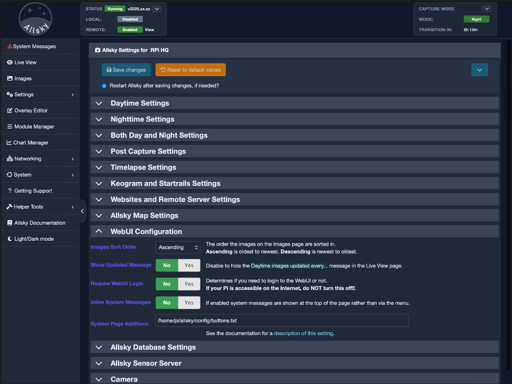

After you install Allsky for the first time there are many settings you must modify via the WebUI's Allsky Settings page. If you are upgrading from a recent prior release those settings can optionally be brought to the new release. Settings that change the look and feel of an Allsky Website are described [here](settings/website.md)  .

The list of settings available in the WebUI depends on your camera model; settings specific to a camera type (e.g., RPi or ZWO) are indicated as such in the table below. Where appropriate, the WebUI displays the minimum, maximum, and default values when you hover over a value, and only displays settings the camera supports, like cooler temperature for cooled cameras. On a phone, swipe the settings tables sideways to read the full descriptions.

## Using the Settings page

The page opens in **category view**. On a desktop or tablet, choose a category from the left-hand column, then choose a section such as **Daytime**, **Nighttime** or **Both** across the top of its settings. The controls in that section scroll independently of the category list. The question-mark icon beside a setting opens its help text; a greyed-out control may depend on another setting being enabled. **Show all settings** changes to a continuous view of the categories available at the selected level, with an index for jumping between them. Select **Show categories** to return to the usual view.

The **Settings Level** control is in **WebUI → Settings Fields**. **Beginner** shows the settings used for initial capture and publishing, **Intermediate** also shows fields assigned to that level, and **Advanced** shows every setting supported by your camera. At present, no fields are assigned to Intermediate, so it shows the same settings as Beginner. Changing the level updates the categories, fields and search results immediately. Press **Save changes** to keep the selection for your next visit; the default is Advanced. Hidden settings retain their saved values.

/// caption
Beginner level leaves the most relevant categories visible. The change is marked as unsaved until you save the page.
///

/// caption
On a desktop, categories remain in the left-hand rail while the selected section fills the main area.
///

The **Find a setting** box searches setting names, descriptions and section names as you type. Results show each setting's category and section, which helps distinguish similarly named controls such as daytime and nighttime **Gain**. Select a result to open the correct section and move to that control. Clearing the search returns to the current view.

/// caption
Search results include the setting's location in the category structure.
///

### Tablet and mobile layouts

On a tablet, the category list remains beside the settings, but controls use a single column to leave enough room for their labels and values. The same category, section and search controls work as on a desktop.

/// caption
The tablet layout keeps the category rail and stacks the controls.
///

On a phone, the page begins with **Choose a category**. Tap a category to open its settings, then use the section tabs to switch between parts of that category. **Categories** takes you back to the list. The section tabs can be scrolled sideways when they do not all fit on screen. Search and **Show all settings** are available above the list, so you can go straight to a setting without opening each category.

/// caption
The mobile category list is the starting point for browsing settings.
///

/// caption
After opening a category, use its section tabs or return to **Categories**.
///

### Saving changes

Changing a field does not save it immediately. The page marks altered settings and shows counts beside their categories or sections, so you can move around without losing track of your edits. Press **Save changes** when you are ready; on a phone, the shorter **Save** button stays at the bottom of the screen. Leave **Restart if needed** on when Allsky should restart after a change that requires it, or turn it off to save without restarting. **Reset to defaults** applies to all settings and asks for confirmation, so use it only when you intend to replace your current values.

!!! note "Legend"
    - CD indicates the setting's default is Camera Dependent and is displayed in the WebUI by hovering your cursor over the value.
    - AW indicates a setting who's value is uploaded to your Allsky Website(s) when changed.

??? info "Quick Start: the settings most people change first"

    If you are new to Allsky, this page can feel like far too much all at once. That is normal. The Allsky Settings page is a full operational control panel, not a small first-run wizard, and most users do **not** need to understand every setting before they can get good results.

    In practical use, people usually begin by adjusting a smaller set of settings that has the biggest effect on everyday capture and publishing. The settings listed below are available at **Beginner** level, along with a few essentials such as nighttime capture and the level selector. They are not the only settings that matter, but they are the ones that usually make the biggest difference when you are moving from "it runs" to "it works well".

    ### Day capture

    Daytime capture is usually about getting a clean, stable image without blown highlights, washed-out skies, or strange colour. It is also where many people decide whether they want to save daytime images at all, since saving them continuously will increase disk usage over time.

    The settings people most often revisit are:

    - **Daytime Capture**: turn this on if you want Allsky to capture images during daylight hours.
    - **Daytime Save**: turn this on if you want daytime images to be kept. This is one of the first settings to think about in terms of storage, because saving daytime frames can use a lot more disk space than many new users expect.
    - **Auto-Exposure** and **Max Auto-Exposure**: these are among the most important controls for daytime image quality and usually the first place to look if brightness is wrong.
    - **Auto-Gain**, **Max Auto-Gain**, and **Gain**: these affect brightness and noise. For some cameras they can make daytime capture much easier, while for others they are better used more conservatively.
    - **Auto White Balance**, **Red Balance**, and **Blue Balance**: these are often adjusted when daytime colour looks unnatural.
    - **Delay**: this controls how often daytime frames are taken. Shorter delays mean more captures, which can also mean more disk usage if you are saving daytime images.
    - **Tuning File**: Raspberry Pi camera users sometimes revisit this if they are using a custom daytime tuning profile.

    A sensible aim for daytime capture is not "the brightest possible image". It is a reliable image that looks natural, updates at a sensible rate, and does not generate more stored data than you actually want to keep.

    ### Night capture

    Night capture is where Allsky usually needs the most care. This is the part of the system most people are ultimately interested in, and small changes in settings can make a surprisingly large difference to stars, cloud structure, noise, and overall image character.

    The settings users most often revisit are:

    - **Auto-Exposure** and **Max Auto-Exposure**: these usually have the biggest effect on how well stars, clouds, and faint detail are recorded.
    - **Manual Exposure**: important if you are not relying fully on auto-exposure, or if you want a more fixed and predictable capture style.
    - **Auto-Gain**, **Max Auto-Gain**, and **Gain**: these are often tuned very carefully because gain improves brightness but also increases noise.
    - **Stretch Amount** and **Stretch Mid Point**: these can make faint detail more visible, but they can also change the look of the image dramatically, so they are best adjusted with care. **Moon-dependent stretch** can vary that adjustment as the Moon brightens the sky.
    - **Delay**: this affects how often frames are taken. Smaller delays mean more nighttime frames and therefore more saved data if you are keeping everything.
    - **Binning**: sometimes adjusted for sensitivity, noise, or performance depending on the camera and your goals.
    - **Cooling** and **Target Temp**: relevant for cooled ZWO cameras.
    - **Take Dark Frames** and **Use Dark Frames**: often revisited once a user wants better nighttime noise control and more consistent results.

    Night settings nearly always need more testing than daytime ones. The right choices depend heavily on your camera, lens, sky brightness, local light pollution, and what you want the finished images and timelapse videos to look like.

    ### Local website

    If you want to use the website hosted on the Raspberry Pi itself, the first settings to think about are the ones that affect whether output is published at all and how much of it is retained locally.

    The settings most often changed are:

    - **Use Local Website**: this is the main switch that enables the local website workflow.
    - **Days To Keep on Pi Website**: controls how much website data is kept locally before old files are removed. This is an important disk-usage setting, especially on smaller SD cards.
    - **Upload Every X Images**: determines how often the current image is updated to the website.
    - **Upload Timelapse**, **Upload Keogram**, **Upload Startrails**, and related thumbnail options: these decide which generated outputs are published to the website.
    - **Display Settings**: enable this if you want a settings link shown on the website.
    - **Filename**, **Latitude**, **Longitude**, and **Angle**: these are not website-only settings, but they often matter to how the website behaves or what it displays.

    The local website is usually the simplest publishing option because it does not require remote upload credentials. Even so, it is worth remembering that local publishing still uses disk space on the Pi. If you keep images, thumbnails, timelapses, keograms, and startrails for long periods, storage planning matters.

    ### Remote website

    If you are publishing to a remote Allsky website, the settings that matter most are the ones that control where files go, how they are transferred, and how much data you send.

    The settings users most often need to review are:

    - **Use Remote Website**: enables the remote website workflow.
    - **Image Directory**: one of the settings that causes the most confusion, and one of the most important to get right.
    - **Protocol**: choose the upload method such as `ftps`, `sftp`, `scp`, `rsync`, `s3`, or `gcs`.
    - **Remote Website Port**, **User Name**, and **Password**: required for many remote upload setups.
    - **Website URL** and **Image URL**: these must match the way the remote website is actually served.
    - **Upload Every X Images** and the upload options for timelapse, keograms, startrails, and mini-timelapses: these control what gets sent and how often. They are important not only for bandwidth, but also for remote storage use if your hosting space is limited.
    - **Resize Uploaded Images Width** and **Resize Uploaded Images Height**: often revisited to reduce upload size, bandwidth use, and the amount of storage consumed remotely.
    - **Upload With Original Name**: usually left off unless you have a specific reason to preserve timestamped filenames remotely.

    Remote website settings usually take a little more care than local ones because they depend on the configuration of the destination server, not just on the Raspberry Pi. They also affect network usage and, depending on how the remote site is managed, can affect storage costs or storage limits there as well.

    ### One practical approach

    If you are not sure where to start, a sensible order is:

    1. Get daytime capture working acceptably.
    2. Tune nighttime capture once the camera is running reliably.
    3. Enable the local website if you want simple on-device publishing.
    4. Move on to the remote website only after the local capture and output workflow already makes sense.

    That sequence usually keeps the initial setup much easier to understand.

??? info "Choosing between Auto and Fixed exposure or gain"

    One of the most common practical decisions in Allsky is whether you should let the software control exposure and gain automatically or whether you should set them to fixed values yourself.

    This is not just a technical preference. It changes how Allsky behaves across the night, how consistent your saved images look, how clean your timelapse videos appear, and how much manual tuning you need to do over time.

    There is no universal answer that suits every camera, every sky, and every style of use. The best choice depends on what matters most to you:

    - convenience,
    - consistency,
    - responsiveness to changing conditions,
    - noise,
    - and how much time you want to spend refining the setup.

    ### Auto-Exposure

    In Allsky, auto-exposure is often the easiest way to get a new installation working reasonably well without constant manual intervention.

    **Benefits**

    - It adapts to changing sky brightness automatically.
    - It is especially useful when brightness changes quickly because of cloud, haze, twilight, Moon phase, or local lighting.
    - It is usually the best starting point for users who are still learning how their own camera behaves.
    - It reduces the amount of retuning needed as conditions change through the year.

    **Drawbacks**

    - Exposure can vary from frame to frame, which may make a timelapse look less consistent.
    - If the scene contains strong bright areas, the automatic system may make choices that are technically reasonable but not visually what you wanted.
    - Users who want tightly controlled comparisons between nights often prefer less automatic variation.
    - If the maximum allowed exposure is set too high, the system may spend long periods taking and saving slow frames. That does not necessarily increase the total number of files, but it does affect the rhythm of capture and therefore the look of saved sequences and timelapses.

    **When to use it**

    Auto-exposure is usually the best choice for most users at the start, especially:

    - during the day,
    - during twilight,
    - when sky conditions change frequently,
    - when you are still learning how your camera behaves.

    **When fixed exposure may be better**

    Fixed exposure can be a better choice when:

    - you already know the exposure range that works well for your site,
    - you want more consistent frame-to-frame behaviour,
    - you are deliberately testing or comparing results in a controlled way,
    - you want a more repeatable look in saved images and timelapses,
    - you are trying to remove one source of variation while tuning other settings.

    ### Auto-Gain

    In Allsky, gain is one of the settings that most obviously trades brightness against image cleanliness. That is why auto-gain needs a little more care than auto-exposure.

    **Benefits**

    - It helps keep images bright enough as conditions change.
    - It can be useful when exposure alone is not giving stable results.
    - It is often helpful with Raspberry Pi cameras, where automatic behaviour can be more practical than constant manual refinement.

    **Drawbacks**

    - Increasing gain also increases noise.
    - Images may become brighter but also rougher, grainier, or less natural.
    - At night, aggressive gain changes can have a strong effect on how clean the final images and timelapses look.
    - On some cameras, especially in nighttime use, auto-gain can produce behaviour that feels less predictable than many users expect.
    - With some ZWO workflows, combining auto-exposure and auto-gain can need careful testing because the two systems may interact in ways that are harder to tune by eye.

    **When to use it**

    Auto-gain is often useful when:

    - you want Allsky to look after itself more aggressively,
    - conditions vary enough that fixed gain becomes frustrating,
    - you are using a Raspberry Pi camera and want a simpler starting point,
    - convenience matters more to you than getting the cleanest possible image every time.

    **When fixed gain may be better**

    Fixed gain is often preferred when:

    - you want to minimise noise,
    - you already know a gain value that works well for your camera and sky,
    - you are tuning nighttime capture carefully,
    - you want more predictable results from one image to the next,
    - you care about giving your timelapse a steadier visual character.

    ### Auto plus fixed starting values

    A detail that is easy to miss in Allsky is that enabling auto-exposure or auto-gain does not always make the fixed-value fields irrelevant.

    In several cases, the manual exposure or gain value becomes the **starting point** from which the automatic system begins adjusting. This means those fields still matter even when you are operating in automatic mode. If the starting point is poor, Allsky may take longer to settle, especially after startup or around the day-to-night and night-to-day transitions.

    ### A practical rule of thumb

    If you are unsure what to do:

    - start with **auto-exposure** enabled,
    - use **auto-gain** more cautiously,
    - prefer lower fixed gain when image noise matters to you,
    - move to fixed values only after you understand how your own camera, lens, and sky conditions behave.

    In practical use, many people end up with a mixed approach:

    - automatic control where conditions vary a great deal,
    - fixed values where they want more consistency, less noise, or a steadier timelapse.

    That is often the most sensible Allsky balance. Use the automatic controls to get stable and usable capture first, then move towards fixed values only if you have a clear reason to prefer consistency over flexibility.

## Daytime { data-toc-label="Daytime" id="Daytime-settings"}

| WebUI Setting | Default | Description |
|---|---:|---|
| ==Daytime Capture== | Yes | Enable to ==capture== images during the day. |
| ==Daytime Save== AW | No | Enable to ==save== images during the day (they are always saved at night). Only applies if ==Daytime Capture== is enabled. |
| ==Auto-Exposure== | Yes | Turns on/off Auto-Exposure, which delivers properly exposed images even if the overall brightness of the sky changes due to cloud cover, sun, etc. |
| ==Max Auto-Exposure== CD | CD | The maximum exposure in milliseconds when ==Auto-Exposure== is enabled. Ignored if ==Auto-Exposure== is disabled.    When ==Auto-Exposure== and ==Consistent Delays Between Images== are both on, the time between the start of one image and the start of the next images is the ==Max Auto-Exposure + Delay==. |
| ==Manual Exposure== | 0.5 | Manual exposure time in milliseconds. If ==Auto-Exposure== is on this value is used as a starting exposure.    The time between the start of one image and the start of the next images will be the ==Manual Exposure + Delay==, regardless of the status of ==Consistent Delays Between Images==. |
| ==Mean Target== | 0.5 | The target mean brightness level when ==Auto-Exposure== is on. Ranges from 0.0 (pure black) to 1.0 (pure white). Best used when both ==Auto-Exposure== and ==Auto-Gain== are enabled. |
| ==Mean Threshold== | 0.1 | When using ==Mean Target==, this specifies how close (plus or minus) the target brightness should be to the ==Mean Target==.    For example, if ==Mean Target== is `0.4` and ==Mean Threshold== is `0.1` then the target brightness ranges from `0.3` to `0.5`. |
| ==Delay== | 5000 | Time in milliseconds to wait between the end of one image and the start of the next. |
| ==Auto-Gain== | No | Turns on/off Auto-Gain which delivers properly exposed images even if the overall brightness of the sky changes. With RPi cameras, this should typically be turned on. With ZWO cameras you'll probably want this off and use the lowest gain possible since daytime images are bright and don't need any gain. |
| ==Max Auto-Gain== CD | CD | Maximum gain when using ==Auto-Gain==. Ignored if ==Auto-Gain== is off. |
| ==Gain== CD | CD | Gain is similar to ISO on regular cameras. When ==Auto-Gain== is on, this value is used as a starting gain. When ==Auto-Gain== is off, increasing this produces brighter images, but with more noise.    The default daytime gain is the minimum possible for the camera since daytime images are normally bright and don't need any additional gain. |
| ==Stretch Amount== | 0 | Stretching increases the contrast of an image without saturating the bright parts or making the dark parts turn black. It is most often used to lighten an image so isn't normally used during the day. This setting determines how much to change the image: 3 is typical and 20 is a lot.    Set to `0` to disable stretching.    See [this page](../explanations/exposureGainSaturation.html#stretch) for more information on stretching images. |
| ==Stretch Mid Point== | 10 | Determines what brightness level in the image should be stretched: 0 stretches black pixels, 50 stretches middle-gray, etc. |
| ==Binning== | 1x1 | Bin 2x2 collects the light from 4 pixels to form one larger pixel on the image. Bin 3x3 uses 9 pixels, etc. Increasing the bin results in smaller, lower-resolution images and reduces the need for long exposure. Look up your camera specifications to know what values are supported.    During the day this setting is usually only changed for testing.     Binning on CCD cameras normally produces brighter images. CMOS camera may, or may not produce brighter images, depending on the camera model. |
| ==Auto White Balance== | No | Sets daytime auto white balance. When used, ==Red Balance== and ==Blue Balance== are used as starting points. |
| ==Red Balance== CD | CD | The intensity of the red component of the image. |
| ==Blue Balance== CD | CD | The intensity of the blue component of the image. |
| ==Frames To Skip== | 5 | When starting Allsky during the day, skip *up to* this many images while the auto-exposure software gets to the correct exposure.    Only applies if daytime ==Auto-Exposure== is enabled. |
| ==Cooling== | No | (ZWO cooled cameras only) Enable to use cooling on cameras that support it. |
| ==Target Temp== | 0 | (ZWO cooled cameras only) Sensor's target temperature *when cooler is enabled*. In degrees Celsius. |
| ==Tuning File== | No | (RPi on Bookworm and Bullseye only) Full path name of the optional daytime tuning file. See the [Raspberry Pi Documentation](https://www.raspberrypi.com/documentation/computers/camera_software.html#tuning-files) for more information.     System-supplied tuning files on Raspberry Pi models prior to 5 are in `/usr/share/libcamera/ipa/rpi/vc4`. New Pi's files are in `/usr/share/libcamera/ipa/rpi/pisp`. |

## Nighttime { data-toc-label="Nighttime" id="Nighttime-settings"}
!!! note
    Unless otherwise specified, these settings are the same as the Daytime ones.

| WebUI Setting | Default | Description |
|---|---:|---|
| ==Nighttime Capture== | Yes | Enable to ==capture== images during the night. |
| ==Nighttime Save== AW | No | Enable to ==save== images during the night. Only applies if ==Nighttime Capture== is enabled. |
| ==Auto-Exposure== | Yes |  |
| ==Max Auto-Exposure== CD | CD |  |
| ==Manual Exposure== | 10000 |  |
| ==Mean Target== | 0.2 |  |
| ==Mean Threshold== | 0.1 |  |
| ==Delay== | 10 |  |
| ==Auto-Gain== | No | With ZWO cameras enabling ==Auto-Exposure== and ==Auto-Gain== together can produce unpredictable results so testing is needed. |
| ==Max Auto-Gain== CD | CD |  |
| ==Gain== CD | CD | The default is one-half the maximum for the camera. |
| ==Stretch Amount== | 0 |  |
| ==Stretch Mid Point== | 10 |  |
| ==Moon-dependent stretch== | No | Varies the nighttime stretch with moonlight. When enabled, the ordinary ==Stretch Amount== and ==Stretch Mid Point== are used with no moonlight, while the two ==Full Moon== settings are used when a full Moon is high in the sky. Allsky interpolates between them as the Moon's brightness and height change. |
| ==Full Moon Stretch Amount== | 0 | Stretch amount for a full Moon high in the sky. Usually lower than the ordinary nighttime ==Stretch Amount== because moonlight already brightens the image. `0` means no stretch. Available when ==Moon-dependent stretch== is on. |
| ==Full Moon Stretch mid point== | 10 | Mid point for the full-Moon stretch. Lower values brighten darker parts of the image; higher values favour lighter parts. Available when ==Moon-dependent stretch== is on. |
| ==Binning== | 1x1 |  |
| ==Auto White Balance== | No |  |
| ==Red Balance== CD | CD |  |
| ==Blue Balance== CD | CD |  |
| ==Frames To Skip== | 1 | Only applies if nighttime ==Auto-Exposure== is enabled. |
| ==Cooling== | No | (ZWO cooled cameras only) |
| ==Target Temp== | 0 | (ZWO cooled cameras only) |
| ==Tuning File== | No | (RPi on Bookworm and Bullseye only) |

The Moon controls appear in the **Nighttime Image Stretch** group. Turn on ==Moon-dependent stretch== to make the two **Full Moon** fields editable. The ordinary stretch fields remain the values for nights with no moonlight. The picture shows the switch enabled so that all four values can be seen together.

/// caption
The Moon-dependent stretch controls in the Nighttime section.
///

## Day and Night { data-toc-label="Day and Night" id="Both-settings"}

| WebUI Setting | Default | Description |
|---|---:|---|
| ==Days To Keep== | 14 | Number of days of images and videos in `~/allsky/images` to keep. Any directory older than this many days will be deleted at each end of night. Set to `0` to keep ==ALL== days' data; you will need to manually manage disk space. |
| ==Configuration File== | [none] | Configuration file to use for settings. Not currently used. |
| ==Extra Arguments== |  | (RPi only) Any additional parameters to send to the `libcamera-still` image capture program. It supports a lot of settings that Allsky doesn't (e.g., auto-focus options), and this field allows you to enter those settings. |
| ==Saturation== CD | CD | (RPi only) Sets saturation from black and white to extra saturated. |
| ==Contrast== CD | CD | (RPi only) Changes the difference between blacks and whites in an image. |
| ==Sharpness== CD | CD | (RPi only) Changes the sharpness of an imgage. Images that are too sharp look unnatural. |
| ==Aggression== | 75% | (ZWO only) Specifies how much of a calculated exposure change should be made during auto-exposure. Lower numbers smooth out brightness changes but take longer to react to changes. |
| ==Gain Transition Time== | 15 | (ZWO only) Number of ==minutes== over which to increase or decrease the gain when going from day-to-night or night-to-day images. This helps smooth brightness differences. Only works if nighttime ==Auto-Gain== is off. `0` disables transitions. |
| ==Image Type== | auto | Image format: ==auto== automatically picks the best type of image based on the camera. If you have a color camera it will use RGB24; mono cameras use RAW16 if the output file is a .png, otherwise RAW8 is used. ==RAW8==: 8-bit mono. ==RGB24==: color (red, green, blue), 8 bits per channel. ==RAW16==: 16-bit mono. |
| ==Quality / Compression== | 95 | For JPG images, this specifies the quality - 0 (low quality) to 100 (high quality). Larger numbers produce higher-quality, but larger, files. For PNG, this is the amount of compression - 0 for no compression (but quicker to save) to 9 for highest compression (but slowest to save). If you use very short delays between pictures you may want to play with these numbers to get the quickest delay possible. |
| ==Auto USB Bandwidth== | Yes | (ZWO only) Automatically sets the ==USB Bandwidth==. |
| ==USB Bandwidth== CD | CD | (ZWO only) How much of the USB bandwidth to use. |
| ==Filename== AW | image.jpg | The name of the image file. Supported extensions are ==jpg== and ==png==. |
| ==Rotation== | None | (RPi on Bookworm and Bullseye only) How to rotate the image. Choices are 0 and 180 degrees. |
| ==Flip== | No flip | How to flip the image (No flip, Horizontal, Vertical, or Both). |
| ==Focus Mode== | No | Enable to have images created and displayed as fast as possible, to aid in focusing. Other than adding the focus metric (see next setting) to each image, no other post-processing is performed - no resizing, no overlay or other modules are run, images aren't permanently saved or uploaded, and there is no delay between images - as soon as an image is available and the focus metric added, the next image is taken.    The WebUI's ==Live View== refreshes the image every second or so. Because this happens so quickly, it's possible the Live View page will try to read the image as it's being updated, so you may see occasional "glitches". |
| ==Record Focus== | No | Enable to have the overall focus of the image determined and output via the `FOCUS` variable, which can then be used in an overlay. Unless you are focusing in "Focus Mode" (in which case this setting is enabled), it's not all that useful to see the metric since it can change depending on image brightness and other factors. |
| ==Consistent Delays Between Images== | Yes | Enabling this makes the time between the ==start== of one auto-exposure and the ==start== of the next exposure a consistent length (==Max Auto-Exposure + Delay==). Timelapse video frames will be equally spaced.    For example, if the ==Max Auto-Exposure== is 60 seconds and the ==Delay== is 30 seconds, the start of an exposure will be exactly 90 seconds after the prior exposure's start time, regardless of how long an individual frame's exposure is. So if the first exposure was only 3 seconds, the second exposure will still start 90 seconds after the first one.    Disabling this means the time between exposure starts varies depending on the actual length of each exposure. At nighttime when most exposure are at their maximum length this setting doesn't make a difference, but during the day or at twilight the exposure length is usually not at the maximum.    Note that if manual exposure is used this setting doesn't apply since the time between exposures (==Manual Exposure + Delay==) is always the same. |
| ==Time Format== | `%Y%m%d %H:%M:%S` | Determines the format of the displayed time. Run `man 3 strftime` to see the options. |
| ==Temperature Units== | Celsius | Determines what unit(s) the temperature will be displayed in (Celsius, Fahrenheit, or Both). |
| ==Latitude== AW |  | Latitude of the camera. Formats include: `123.4N`, `123.4S`, `+123.4`, or `-123.4`. Southern hemisphere is negative. The `+` is needed for positive numbers. |
| ==Longitude== AW |  | Longitude of the camera. Formats include: `123.4E`, `123.4W`, `+123.4`, or `-123.4`. West is negative. The `+` is needed for positive numbers.     The actual values for latitude and longitude are not displayed on the map, but users can zoom in to see exactly where your camera is. If that bothers you, change the latitude and/or longitude values slightly. Allsky itself only uses them to determine when daytime and nighttime begin so you can change the values a fair amount and not impact anything.     When installing Allsky the first time, the installation script will attempt to determine your rough ==Latitude== and ==Longitude== based on your IP address. These values may be "close enough" in most cases but you may want to check them anyhow. |
| ==Angle== AW | -6 | Altitude of the Sun above or below the horizon at which daytime and nighttime switch. This is stored as a decimal number of degrees, so values such as `-6.5` are valid. It can be negative (Sun below the horizon) or positive (Sun above the horizon).    - `0` = Sunset   - `-6` = Civil twilight   - `-12` = Nautical twilight   - `-18` = Astronomical twilight    [Click here](/docs/allsky_guide/howtos/angle_sunrise_sunset.html) for a more detailed description of ==Angle==. |
| ==Take Dark Frames== | No | Enable to take dark frames which are use to decrease noise in images.    See the [in-depth explanation](/docs/allsky_guide/howtos/dark_frames.html) of dark frames, including how to take and use them. |
| ==Remove Bad Darks Threshold High== | 0.05 | Any dark frame that has a mean brightness higher than this number is not saved.    If you're getting messages about "bad images" while taking dark frames, first make sure your lens is ==FULLY covered== and ==NO== light is getting in.    If you are positive no light is getting in and your camera is noisy, then increase this to `0.1` and see if it helps. If not, then increase it more. |
| ==Use Dark Frames== | No | Enable to perform dark frame subtraction at night. Requires that you first took dark frames using ==Take Dark Frames==. |
| ==Locale== |  | The locale is used to determine what the thousands and decimal separators are as well as the language to use for many non-Allsky commands. If you have never set the locale in Allsky, the installation script will display a list of locales installed on your Pi, highlighting the current one. If it's the correct one, press TAB until the cursor is over `<Ok>`, then press ENTER.     The locale only needs to be set once and won't change unless you reinstall the Pi OS. Changing the locale requires a reboot, which ==must== be done before continuing the installation.    If the correct locale isn't in the list it needs to be installed, so cancel out of the installation and run `sudo raspi-config`, selecting `Localisation Options`, followed by the `Locale` option. You will be shown a drop-down list with hundreds of locales; when you find the correct one for your language and country, press SPACE, then TAB to the `<Ok>` button. When done, re-run the installation script selecting the locale you just installed. |
| ==ZWO Exposure Type== | Snapshot | (ZWO only) Determines what type of exposures to take:    1. ==Snapshot== takes pictures one at a time like a "normal" camera. Note that ==Auto-Gain== and ==Auto White Balance== do not work when ==Snapshot== is used.   2. ==Video Off== takes pictures like a video camera that is turned off after every picture. This is the same as the old ==Version 0.8 exposure== setting.   3. ==Video (original)== takes pictures like a video camera that is always on. This is the original exposure method.    The first two types decrease the sensor temperature between 5 - 15 degrees Celsius. |
| ==Histogram Box== | 500 500 50 50 | (ZWO only) X and Y size of histogram box in pixels and the middle point of the box in percent. This box is used to determine the average brightness of the image for auto-exposure compensation. If the Sun goes through the center of your image you may want to move the box. |
| ==Debug Level== | 1 | Determines the amount of output in the Allsky log file:    - `0` outputs error messages only.   - `1` outputs "what's happening" type messages.   - `2` outputs more "what's happening" messages.   - `3` outputs debugging information. ==Use this level when debugging problems.==   - `4` outputs a LOT of INFO messages. Use only if directed to by an Allsky developer. |

### Using the Day and Night pickers

The buttons beside some fields open an editor without changing the setting immediately. Choose a value in the popup, apply it to the field, then save the Settings page to keep the change. You can still type directly into these fields.

The disk button beside ==Days To Keep== opens an estimate based on the space used by recent image folders and the free space on the images disk. Choose a common retention period or enter a whole number of days. The estimate changes with your choice; it is a guide rather than a guarantee, since each day's images may occupy a different amount of space. **Keep all** sets the value to `0` and disables automatic age-based deletion.

/// caption
The storage estimate for a 14-day retention period.
///

The calendar button beside ==Time Format== opens a format builder. Select a date and time style and press **Fill pattern**, or edit the `strftime` pattern yourself. The live preview shows the result before you press **Use format**. The **Format code reference** can be opened when you need a code; its search and category controls help you find one without leaving the editor.

/// caption
The format builder and its live preview.
///

The map button beside ==Latitude== or ==Longitude== opens one location picker for both coordinates. Move or zoom the map, then click the camera location and press **Save** in the popup. This fills both fields; save the Settings page afterwards. You may also enter either coordinate directly if you need a precise value.

/// caption
The location picker updates latitude and longitude together.
///

The globe button beside ==Locale== lists available locales and marks those already installed, including the active one. Search by locale name and select an entry to fill the field. A locale marked **Available to enable** may need to be enabled in the operating system before it can be used; the notice under the field tells you when that applies.

/// caption
The locale picker distinguishes installed locales from those available to enable.
///

The Angle picker shows how a decimal value affects the times at which the Sun crosses the chosen altitude. You can enter a value directly, use the slider, or choose a common twilight angle. The example below uses `-6.5°`; applying it places `-6.5` in the setting, and saving the page stores it as a number.

/// caption
The Sun-angle picker with a decimal angle selected.
///

## Post Capture { data-toc-label="Post Capture" id="Post-capture-settings"}

| WebUI Setting | Default | Description |
|---|---:|---|
| ==Remove Bad Images Threshold Low== | 0.1 | Images whose mean brightness is below this will be removed. Useful values range from `0.01` to around `0.2`. Set to `0` to disable this check. |
| ==Remove Bad Images Threshold High== | 0.9 | Images whose mean brightness is above this will be removed. Useful values range from `0.8` to around `0.95`. Set to `0` to disable this check. |
| ==Remove Bad Images Threshold Count== | 5 | Display a System Message when this many consecutive "bad images" are taken. A notification image will also be displayed telling you how many consecutive bad images there are. Once a "good" image is taken, the notification image will be replaced by the good image. |
| ==Create Image Thumbnails== | Yes | Create thumbnails of the images and save in `~/allsky/images`? If you never look at them via the WebUI's ==Images== page, consider changing this to "No". |
| ==Thumbnail Width== | 100 | Sets the width of image and video thumbnails. |
| ==Thumbnail Height== | 75 | Sets the height of image and video thumbnails. These numbers determine the size of the thumbnails in `~/allsky/images` as well as any thumbnails created by the Allsky Website.     Although changing these will change the size of the thumbnails, no testing has been done to see if there are negative side effects. |
| ==Image Resize Width== | 0 | The width to resize images to. Large sensor cameras like the RPi HQ may need to be resized (shrunken) in order for timelapses to work. Resizing is done before cropping. Must be an even number and `0` disables resizing. |
| ==Image Resize Height== | 0 | Same as ==Image Resize Width== but for the image height. Typically you'll want the Width/Height ratio to be the same as the sensor's width/height ratio, otherwise images will be distorted. |
| ==Image Crop Top== | 0 | Number of pixels to crop off the top of an image. This is often used to remove the dark areas around an image when using a fisheye lens. All the Crop numbers should either be `0` to disable cropping that side of an image, or a positive number. |
| ==Image Crop Right== | 0 | Number of pixels to crop off the right side of an image. |
| ==Image Crop Bottom== | 0 | Number of pixels to crop off the bottom an image. |
| ==Image Crop Left== | 0 | Number of pixels to crop off the left side of an image. |

## Timelapse { data-toc-label="Timelapse" id="Timelapse-settings"}
???+ note "Daily Timelapse"

    

    | WebUI Setting | Default | Description |
    |---|---:|---|
    | ==Generate== | Yes | Enable to generate a timelapse video at the end of the night. |
    | ==Start Time== |  | Only use images taken at or after this time in the timelapse. Empty uses the first image of the day. See [Start and End Times](#Start-end-times) for the values you can use. |
    | ==End Time== |  | Only use images taken at or before this time in the timelapse. Empty uses the last image of the day. See [Start and End Times](#Start-end-times). |
    | ==Width== | 0 | Changes the width of the generated timelapse; must be an even number. `0` uses the image's full size. Large sensor cameras like the RPi HQ often need the timelapse to be shrunk in order for timelapses to work (or the individual images need to be shrunk). |
    | ==Height== | 0 | Changes the height of the generated timelapse; must be an even number. `0` uses the image's full size. If you change the width and height you'll probably want the resulting aspect ratio to match the original images. |
    | ==Bitrate== | 5000 | Bitrate the timelapse video will be created with, in kilobytes. Higher values produce better quality video but larger files. Do ==NOT== add a trailing `k`. |
    | ==FPS== | 25 | The timelapse video ==F==rames ==P==er ==S==econd. Higher numbers produce smoother, but shorter, videos. |
    | ==Keep Sequence== | No | Keep the sequence of symbolic links created when creating a timelapse? Primarily used when debugging. |
    | ==Extra Parameters== |  | Any additional timelapse parameters. If video quality is poor or videos don't play on Apple devices, try adding `-level 3.1`. Run `ffmpeg -?` to see the options. |

    

???+ note "Mini-Timelapse"

    !!! note
        Several of these settings are similar to the setting with the same name for daily timelapses. In those cases, only differences are noted.

    

    | WebUI Setting | Default | Description |
    |---|---:|---|
    | ==Number Of Images== | 0 | A "mini-timelapse" only includes the most recent images and is created often. It's a good way to see "recent" activity. This setting determines the number of images in the mini-timelapse. Keep in mind the more images you have the longer it'll take to create the video. 30 is a good starting point. `0` disables mini-timelapse creation.    ==Note that each mini-timelapse overwrites the prior one.==    The following settings only apply if this setting is greater than 0. |
    | ==Force Creation== | No | Should a mini-timelapse be created even if ==Number Of Images== images haven't been taken yet? For example, you want 15 images in each mini-timelapse but only 5 have been taken; should a mini-timelapse still be created? |
    | ==Frequency== | 5 | After how many images should the mini-timelapse be created? Slower machines and machines with slow networks should use higher numbers. 3-5 works well on a Pi 4 with 4 GB memory. Every ==Frequency== images a new mini-timelapse is created using the last ==Number Of Images== images.     ?? Be ==very== careful when setting ==Number Of Images== and ==Frequency==. If either or both numbers are too high, or the daytime/nighttime ==Delay== is too short, there may not be enough time to finish one mini timelapse creation before the next one starts. If this happens the second one will be aborted and you'll see a System Message in the WebUI. |
    | ==Width== | 0 |  |
    | ==Height== | 0 |  |
    | ==Bitrate== | 2000 | This is normally smaller than a full timelapse to save on processing time. |
    | ==FPS== | 5 | Mini-timelapses contain a small number of images so this setting should be low to avoid very short videos. |

    

???+ note "Both Timelapses"

    

    | WebUI Setting | Default | Description |
    |---|---:|---|
    | ==VCODEC== | libx264 | Encoder used to create the timelapse video. Rarely changed. Run `allsky-config encoders` for a (long) list. |
    | ==Pixel format== | yuv420p | Pixel format. Rarely changed. Run `allsky-config pix_fmts` for a (long) list. |
    | ==Log Level== | Warning | Level of debugging information output when creating a timelapse. Set to ==Info + Warnings + Errors== for more output. Primarily used for debugging or when tuning the algorithm. |

    

The buttons beside ==VCODEC== and ==Pixel format== open searchable lists of the video encoders and pixel formats reported by `ffmpeg` on this system. The current value is marked in each list. Search by name or description, then select an entry to fill its field. These settings normally work best at their defaults; change them when a particular player or output format requires it.

/// caption
Search narrows the video encoder list to matching entries.
///

/// caption
The pixel format picker shows the format name and its component and bit-depth details.
///

## Keogram and Startrails { data-toc-label="Keogram / Startrails" id="Keogram-startrails-settings"}
???+ note "Keograms"

    

    | WebUI Setting | Default | Description |
    |---|---:|---|
    | ==Generate== | Yes | Enable to generate a keogram image at the end of the night. |
    | ==Start Time== |  | Only use images taken at or after this time in the keogram. Empty uses the first image of the day. See [Start and End Times](#Start-end-times) for the values you can use. |
    | ==End Time== |  | Only use images taken at or before this time in the keogram. Empty uses the last image of the day. See [Start and End Times](#Start-end-times). |
    | ==Expand== | Yes | Enable to expand keograms to the image width. Same as the `--image-expand` and `-x` options. |
    | ==Font Name== | Simplex | Font name. |
    | ==Font Color== | #ffffff (white) | Color of the date/time label on the keogram. Same as the `--font-color` and `-C` options.    The color can be specified using one of the following:   1. Three comma- or space-separated numbers between `0` and `255` in RGB order. Example: `0,255,0` (green), `255 0 1` (red with a tiny bit of blue).   2. `#` followed by ==six== hex digits `00` to `ff` in RGB order. Example: `#00ff00` (green), `#ff0001` (red with a tiny bit of blue).   3. `#` followed by ==three== hex digits `0` to `f` in RGB order. Example: `#0f0` == `#00ff00` (green), `#f00` == `#ff0011` (red with a little bit of blue).    Hex digits include 0-9 and a-f, where hex `a` = decimal `10`, ... hex `f` = decimal `15`. Hex `10` = decimal `16` and hex `ff` = decimal `255`.    Larger values mean more of that color: `#000000` is black, `255 255 255` is white, `128,128,128` is middle gray. |
    | ==Font Size== | 2 | Font size. Same as the `--font-size` and `-S` options. |
    | ==Font Line Thickness== | 3 | Thickness of the font's line. Same as the `--font-line` and `-L` options. |
    | ==Extra Parameters== |  | Optional additional keogram creation parameters. Execute `~/allsky/bin/keogram --help` for a list of options. |

    

???+ note "Startrails"

    

    | WebUI Setting | Default | Description |
    |---|---:|---|
    | ==Generate== | Yes | Enable to generate a startrails image at the end of night. |
    | ==Start Time== |  | Only use images taken at or after this time in the startrails. Empty uses the first image of the day. See [Start and End Times](#Start-end-times) for the values you can use. |
    | ==End Time== |  | Only use images taken at or before this time in the startrails. Empty uses the last image of the day. See [Start and End Times](#Start-end-times). |
    | ==Brightness Threshold== | 0.1 | Average brightness level above which images are discarded (moon, headlights, aurora, etc.). If you are only getting very short trails, or none at all, adjust this number. Values are 0.0 (pure black, filters out nothing) to 1.0 (pure white, uses every image). |
    | ==Extra Parameters== |  | Optional additional startrails creation parameters. Execute `~/allsky/bin/startrails --help` for a list of options. |

    

## Start and End Times { data-toc-label="Start / End Times" id="Start-end-times"}

The ==Start Time== and ==End Time== settings of the [Daily Timelapse](#Timelapse-settings), [Keogram, and Startrails](#Keogram-startrails-settings) select which of a day's images are used. Only images in that day's `~/allsky/images/YYYYMMDD` folder are used, so the result can cover less than a day, never more. That folder holds the images from the start of one day through the end of the following night.

Each setting can be one of these values. Upper and lower case don't matter.

| Value { .w-20p } | Meaning |
|---|---|
| (empty) | ==Start Time==: the first image in the folder. ==End Time==: the last image. |
| `HH:MM` or `HH:MM:SS` | A 24-hour clock time, for example `18:00` or `22:30:00`. |
| `sunrise`, `sunset` | When the Sun rises or sets at your ==Latitude== and ==Longitude==. These don't depend on the ==Angle== setting. |
| `daytime_start` | The time of the ==first daytime== image in the folder. |
| `daytime_end` | The time of the ==last daytime== image in the folder. |
| `nighttime_start` | The time of the ==first nighttime== image in the folder. |
| `nighttime_end` | The time of the ==last nighttime== image in the folder, normally the next morning. |

The clock button beside either time field opens the same picker for both ends of the interval. Switch between **Start Time** and **End Time** at the top. The **Clock time** view provides a dial and a typed-time option; **Sun event** offers the named values listed above. **Clear time** removes the limit for the selected end. Press **Apply** to fill the fields, then save the Settings page. The same picker is used for daily timelapses, keograms and startrails.

/// caption
The time picker lets you edit both ends of an interval in one popup.
///

An ==End Time== earlier than the ==Start Time== is on the next day, so a ==Start Time== of `18:00` and an ==End Time== of `06:00` works.

Whether an image is a daytime or nighttime image is Allsky's own decision when it took the image, the same one that decides between the daytime and nighttime settings. It's read from the Allsky database. If the database has no entries for that day, the `daytime_*` and `nighttime_*` times are when the Sun crosses the ==Angle== setting instead.

???+ info "`daytime_end` versus `nighttime_start`"

    Both mark the evening change from day to night, but they are the times of two ==different== images:

    - `daytime_end` is the time of the ==last image Allsky took in daytime mode==.
    - `nighttime_start` is the time of the ==first image Allsky took in nighttime mode==, normally the very next image.

    They are usually one daytime ==Delay== plus one exposure apart, so a minute or two. The difference matters because the times are inclusive:

    | Setting | Includes the last daytime image? | Includes the first nighttime image? |
    |---|:---:|:---:|
    | ==Start Time== `daytime_end` | Yes | Yes |
    | ==Start Time== `nighttime_start` | No | Yes |
    | ==End Time== `daytime_end` | Yes | No |
    | ==End Time== `nighttime_start` | Yes | Yes |

    The same applies in the morning to `nighttime_end` (the last nighttime image) and `daytime_start` (the first daytime image of the folder, which is the morning ==before== the night).

    In practice:

    - For ==nighttime images only==, for example startrails, use `nighttime_start` to `nighttime_end`. The last daytime image is often bright twilight and would spoil startrails.
    - For ==daytime images only== use `daytime_start` to `daytime_end`.

    If the database has no entries for the day, `daytime_end` and `nighttime_start` are the same time, so the difference disappears.

!!! tip "Testing"
    To see which images a window would use without waiting for the end of the night, run `generateForDay.sh` with `--start` and `--end`, for example:   `generateForDay.sh --timelapse --start nighttime_start --end 02:00 20261002`

When you change one of these settings in the WebUI, Allsky checks the value. If it isn't one of the values above, you'll get a warning and the setting goes back to its old value.

## Websites and Remote Server { data-toc-label="Websites / Remote" id="Websites-settings"}
!!! note
    Allsky supports uploading files to a local (on your Pi) Website, a remote Website, and/or a remote server that is ==NOT== an Allsky Website.

| WebUI Setting | Default | Description |
|---|---:|---|
| ==Resize Uploaded Images Width== | 0 | Set to an even number to resize images that will be uploaded. This decreases the size of uploaded files and saves network bandwidth. Further, images from cameras with large sensors won't fit on most monitors at full resolution, so in effect it's a waste to have large images. Set to `0` to disable resizing. |
| ==Resize Uploaded Images Height== | 0 | Same as ==Resize Uploaded Images Width== but for the height. If that setting is `0` this setting must be as well. |
| ==Upload Every X Images== | 1 | How often should the current image be uploaded? This is useful for slow or costly networks. `0` disables uploading images. Note that startrails, keograms, and timelapse videos have their own upload settings. |
| ==Upload Timelapse== | Yes | Enable to upload the timelapse video to an Allsky Website and/or remote server. If not set, the timelapse videos can still be viewed via the WebUI. Ignored if you do not have an Allsky Website or remote server. |
| ==Upload Timelapse Thumbnail== | Yes | Enable to upload the timelapse video's thumbnail to your Allsky Website. Many remote servers don't support thumbnail creation so the thumbnail needs to be created on the Pi and uploaded. Not needed if your only Allsky Website is on your Pi. |
| ==Upload Keogram== | Yes | Enable to upload the keogram image to an Allsky Website and/or remote server. |
| ==Upload Startrails== | Yes | Enable to upload the startrails image to an Allsky Website and/or remote server. |
| ==Upload Mini-Timelapse== | Yes |  |
| ==Upload Mini-Timelapse Thumbnail== | Yes |  |
| ==Display Settings== | No | People sometimes ask others what settings they are using. Enable this setting to add a link to your Allsky Website's right-side popout that displays your settings. This only works if you are running the Allsky Website. |

???+ note "Local Website"

    

    | WebUI Setting | Default | Description |
    |---|---:|---|
    | ==Use Local Website== | No | Enable to use a ==local== Allsky Website. No other settings are needed for a local Website. If you were using a local Website and disable it you will be asked if you want to keep or remove the saved images, keograms, startrails, and timelapse videos. Either way, the Website itself is not removed nor are its settings so you can easily re-enable it and pick up where you left off. |
    | ==Days To Keep on Pi Website== | 14 | Any image, video, or thumbnail older than this many days will be deleted at each end of night. `0` disables the check and keeps ALL days' web data; you will need to manually manage disk space. |

    

???+ note "Remote Website"

    

    | WebUI Setting | Default | Description |
    |---|---:|---|
    | ==Use Remote Website== | No | Enable to use a ==remote== Allsky Website. Enable the Website ==BEFORE== you [install](/docs/allsky_guide/website.html) it since the installation needs the settings below. |
    | ==Image Directory== |  | Name of the directory the current image should be uploaded to.     This setting is a major cause of confusion for many users. If you don't know what to enter, ask the person or company supporting the server or look in [Troubleshooting -> Uploads](/docs/allsky_guide/troubleshooting/uploads.html) for more information. |
    | ==Protocol== | ftps | Specifies how files should be uploaded to the remote Website.    - `ftps`: secure FTP   - `sftp`: SSH file transfer   - `ftp`: insecure FTP *(not recommended)*   - `scp`: secure copy   - `rsync`: rsync copy   - `s3`: Amazon Web Services   - `gcs`: Google Cloud Storage     `ftp` is unsecure; please use `ftps` or `sftp` instead.    Some of the settings below only apply to certain protocols. |
    | ==Server Hostname== |  | Name of the remote server. Note this is normally ==NOT== the same as the URL used to access the server. |
    | ==Port== |  | (ftp protocols only) Optional port required by the server. Rarely needed. |
    | ==User Name== |  | The username of the login on the remote Website. |
    | ==Password== |  | The password of the login on the remote Website. |
    | ==FTP Commands== |  | (ftp protocols only) Optional command(s) to send to the ftp server prior to transferring files. If you need multiple commands, separate them with a semi-colon. See [Troubleshooting -> Uploads](/docs/allsky_guide/troubleshooting/uploads.html). |
    | ==SSH Public Key File== |  | (scp and rsync protocols only) Path to the SSH public key file.    You need to set up SSH key authentication on your server. First generate a key on your Pi:    `ssh-keygen -t rsa`  Leave the default filename and use an empty passphrase. Then copy the key to your server:    `ssh-copy-id remote_username@remote_server`  Replace `remote_username` and `remote_server` appropriately. If prompted to continue connecting, enter `yes`.    The private key will be stored in `~/.ssh/id_rsa`.    If you are using SSH Key with Amazon Lightsail, copy `ssh-key.pem` to your Pi (e.g., in `~`), run:    `chmod 400 ~/ssh-key.pem`  and set:    - Protocol: `sftp`   - Server Hostname: `remote host name`   - User Name: `remote user name`   - Password: `n/a`   - FTP Commands: `set sftp:connect-program 'ssh -a -x -i /home/pi/ssh-key.pem'` |
    | ==AWS CLI Directory== |  | (s3 protocol only) Directory on the Pi where the AWS CLI tools are installed, typically `${HOME}/.local/bin`. Install and configure:    `pip3 install awscli --upgrade --user` `export PATH=\"${HOME}/.local/bin:${PATH}\"aws configure`  Enter a valid access key ID, Secret Access Key, Default region name (e.g., `us-west-2`), and set Default output format to `json`. |
    | ==S3 Bucket== |  | (s3 protocol only) Name of the S3 bucket where files will be uploaded to (must be in the Default region above). Suggested name: `allskybucket`. Consider turning off/limiting bucket versioning to avoid consuming lots of space with multiple versions of `image.jpg`. |
    | ==S3 ACL== | private | (s3 protocol only) S3 Access Control List (ACL). If you want to serve your uploaded files via http(s), change to `public-read` and ensure bucket policy allows public access. You may need CORS if accessed by JavaScript from a different domain. |
    | ==GCS Bucket== |  | (gcs protocol only) Name of the GCS bucket where files will be uploaded to. Suggested name: `allskybucket`. You need `gsutil` (Google Cloud SDK). See [installation instructions](https://cloud.google.com/storage/docs/gsutil_install). The `gsutil` command must be in standard `$PATH` (usually `/usr/bin`). Authenticate the CLI tool with the correct user. |
    | ==GCS ACL== | private | (gcs protocol only) GCS Access Control List (ACL). Use a predefined ACL rule from [here](https://cloud.google.com/storage/docs/access-control/lists#predefined-acl). To access files over https, set this to `publicRead`. |
    | ==Upload With Original Name== | No | Determines the name of the uploaded image: `image.jpg` (No) or `image-YYYYMMDDHHMMSS.jpg` (Yes). This is rarely used since changing the image name will make it unviewable. |
    | ==Website URL== |  | Your website's URL, e.g. `https://www.mywebsite.com/allsky`.    - If ==Website URL== is specified, ==Image URL== must also be specified, and vice versa.   - Both URLs must begin with `http` or `https`. |
    | ==Image URL== |  | The URL to your allsky image, e.g. `https://www.mywebsite.com/allsky/image.jpg`. Normally this will be the Website URL followed by `image.jpg`. Use https if possible. |
    | ==Days To Keep on Remote Website== | 0 | Number of days of images and videos to retain on the remote Allsky Website. `0` keeps all days. This setting applies when ==Use Remote Website== is enabled; plan for the remote host's available storage when leaving it at `0`. |

    

???+ note "Remote Server"

    !!! note
        These settings are the same as for the Remote Website so are not described.

    

    | WebUI Setting | Default | Description |
    |---|---:|---|
    | ==Use Remote Server== | No | Enable to use a remote server which is ==NOT== running the Allsky Website software. Files will be copied to this server which normally will be a private website where you want to display the most recent images along with other, non-Allsky information. |
    | ==Image Directory== |  |  |
    | ==Protocol== | ftps |  |
    | ==Host name== |  |  |
    | ==Port== |  |  |
    | ==User Name== |  |  |
    | ==Password== |  |  |
    | ==FTP Commands== |  |  |
    | ==SSH Public Key File== |  |  |
    | ==AWS CLI Directory== |  |  |
    | ==S3 Bucket== |  |  |
    | ==S3 ACL== | private |  |
    | ==GCS Bucket== |  |  |
    | ==GCS ACL== | private |  |
    | ==Upload With Original Name== | No | Unless you are using the remote server as a backup, this is ==rarely== used since changing the image name will make it unviewable. |
    | ==Remote Video File Name== | allsky.mp4 | Unless you are using the remote server as a backup, this is ==usually== used so the server knows the file name. |
    | ==Remote Keogram File Name== | keogram.jpg | Unless you are using the remote server as a backup, this is ==usually== used so the server knows the file name. |
    | ==Remote Startrails File Name== | startrails.jpg | Unless you are using the remote server as a backup, this is ==usually== used so the server knows the file name. |

    

## Allsky Map { data-toc-label="Allsky Map" id="Allsky-map-settings"}
!!! note
    If you want your allsky camera's location to display on the [Allsky map](https://www.thomasjacquin.com/allsky-map), the information in this section will be sent to the map server every other morning to ensure it's fresh. The server automatically removes old data. Only a limited number of updates per day are allowed.

| WebUI Setting | Default | Description |
|---|---:|---|
| ==Show on Map== | No | Enable to have your camera appear on the [Allsky map](https://www.thomasjacquin.com/allsky-map). ==If off, the following settings are ignored.== |
| ==Location== AW |  | The location of your camera. You can put any level of detail you want. |
| ==Owner== AW |  | The owner of the camera - your name, an association name, an observatory, etc. |
| ==Lens== AW |  | The lens you're using on your camera, for example: ==Arecont 1.55==. |
| ==Equipment Info== AW |  | Any optional information you want to add about the equipment you are using. For example, if you are using a camera with no infrared filter (a "NoIR" camera). |

## WebUI { data-toc-label="WebUI" id="WebUI-settings"}

| WebUI Setting | Default | Description |
|---|---:|---|
| ==Images Sort Order== | Ascending | Determines how the images for a day in the WebUI's ==Images== page are displayed. ==Ascending== sorts oldest -> newest. ==Descending== sorts newest -> oldest. |
| ==Show Updated Message== | Yes | Determines whether the `Daytime images updated every...` message in the ==Live View== page is shown. |
| ==Require WebUI Login== | Yes | Determines if you need to log into the WebUI. ==If your Pi is accessible on the Internet, do NOT disable this!!== |
| ==Live View Mode== | Full Width | **Full Width** fills the Live View panel and may need vertical scrolling. **Fit Image** scales the image so that all of it remains visible in the panel. |
| ==Inline System Messages== | Yes | Displays system messages at the top of the page. Turn this off to access them through the menu instead. |
| ==Field Help Delay== | 500 ms | Time to wait before showing a setting's help when you hover over it. Set to `0` to show help only when the help icon is clicked. |
| ==Settings Level== | Advanced | Chooses how much of the Settings page to show. Beginner contains the initial setup controls; Intermediate adds fields assigned to that level; Advanced shows all supported fields. The filter takes effect immediately and is saved with the rest of the page. This control is in the **Settings Fields** group. |
| ==Use Field Dependencies== | Yes | Applies the relationships between settings, disabling or hiding controls whose required settings are off or do not match. The page updates immediately when you change this preference; save to keep it. |
| ==Use Field Groups== | Yes | Places related controls in a shared panel, such as the nighttime stretch settings. Turning it off displays those controls separately. The layout changes immediately; save to keep the preference. |
| ==Show Picker Buttons== | Yes | Shows the buttons beside fields that offer a popup editor, including the storage, time format, time, location, Sun angle, locale and video format pickers. You can still enter values directly into the fields when the buttons are hidden. The page updates immediately; save to keep the preference. |
| ==Show All Settings by Default== | No | Opens the Settings page in the continuous **Show all settings** view instead of category view. Changing this option also switches the current page immediately; save to use that view on future visits. |
| ==System Page Additions== |  | One or more colon-separated full path names to text files that contain user-supplied data to display on the WebUI's ==System== page. See [System Page Additions](/docs/allsky_guide/howtos/system_page.html) for more information and an example. |

## Database { data-toc-label="Database" id="Database-settings"}
!!! warning "Database settings"

    Only change the database settings if you know what you are doing.

| WebUI Setting | Default | Description |
|---|---:|---|
| ==Enable Database== | Yes | Enables the Allsky database, which keeps information on images taken like exposure time and a day/night flag. Some Allsky modules update these records (e.g., meteor detection adds the number of meteors). The database enables features like using only nighttime images in startrails. Disabling it will keep many new features from working properly. |
| ==Database== | allsky | The name of the database. |
| ==Database Type== | SQLite | The type of database. MySQL has more features but uses a lot more CPU and memory than SQLite. It would typically only be used if you already have a MySQL database on your Pi (extremely rare). |
| ==Database Host== |  | (MySQL only) The IP address or hostname of the server running the database. By default the database runs on your Pi. |
| ==Database User== |  | (MySQL only) The username used to connect to the database. Suggest using the same as your Pi login so you have one less thing to remember. |
| ==User Password== |  | (MySQL only) The password used to connect to the database.     Keep track of the User and Password - if `~/allsky/env.json` is accidently removed you'll need to enter the User and Password in order for the database to work. |

## Allsky Sensor Server { data-toc-label="Sensor Server" id="Sensor-server-settings"}
The sensor server settings connect this camera to an Allsky Sensor Server. Set the server address and token according to that server's setup instructions. The three connection fields become editable when ==Server Enabled== is on.

| WebUI Setting | Default | Description |
|---|---:|---|
| ==Server Enabled== | No | Enables the connection to an Allsky Sensor Server. Leave it off if you do not use one. |
| ==Allsky Sensor Camera Name== |  | Name by which this camera appears on the sensor server. Choose a name that distinguishes it from any other cameras connected to that server. |
| ==Allsky Sensor URL== |  | Address of the Allsky Sensor Server. Use the URL supplied by the server's setup guide. |
| ==Allsky Sensor Token== |  | Token used to connect to the Allsky Sensor Server, as supplied during its setup. |

## Camera { data-toc-label="Camera" id="Camera-settings"}

| WebUI Setting | Default | Description |
|---|---:|---|
| ==Camera== |  | The camera to use. All cameras connected to the Pi are listed, RPi and ZWO, for example:   `RPi  Module 3 Wide NoIR  [imx708_wide_noir]`   `ZWO  ASI178MC`   RPi cameras show their sensor in brackets.    To use another camera, select it and save the change via the ==Save changes== button. You can't change any other setting at the same time.    If you connect or disconnect a camera on the Pi, select ==Refresh== and save to look for cameras again; the current camera stays selected. A camera that's selected but no longer connected is shown as `(not connected)`. |

## Developer Options { data-toc-label="Developer Options" id="Developer-options-settings"}
These controls are for developing and installing Allsky modules. The repository and branch fields are editable when ==Developer Mode== is enabled. Leave them empty unless you need a particular module source.

| WebUI Setting | Default | Description |
|---|---:|---|
| ==Developer Mode== | Yes | Enables developer features in the WebUI. The [Developer Guide](../../developer_guide/introduction.md) describes the development workflow. |
| ==Repo== |  | GitHub repository from which modules are installed. Specify this when you need modules from a particular repository. |
| ==Branch== |  | Branch of the module repository to use by default. Set it when the required modules are on a branch other than the repository's default. |

