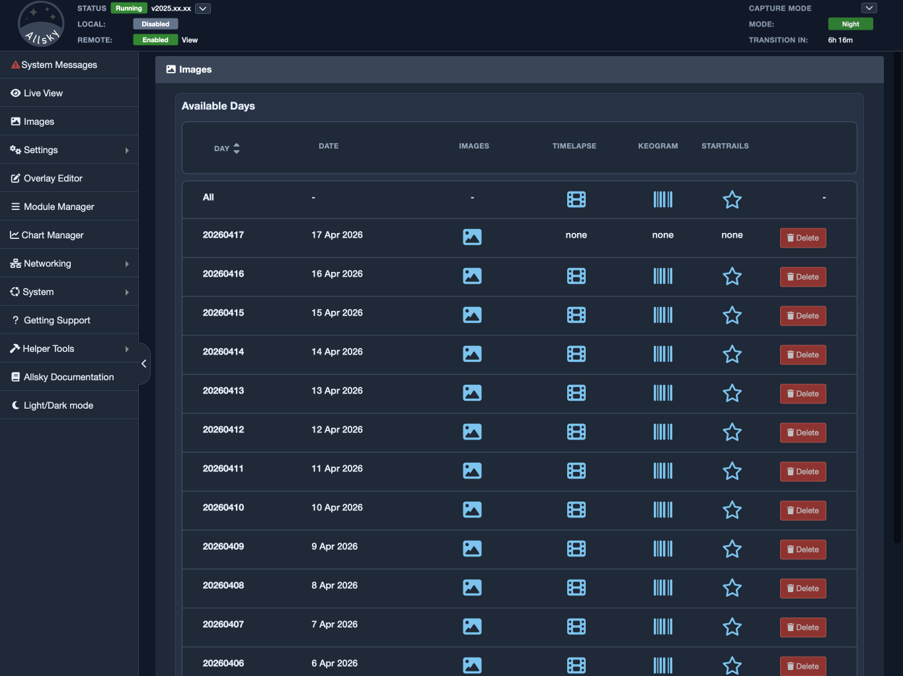
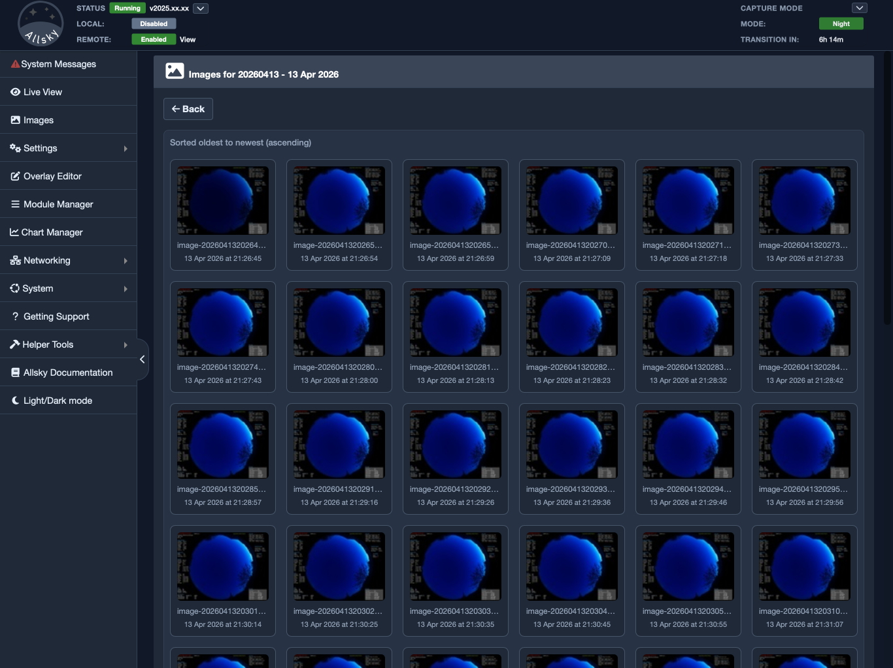
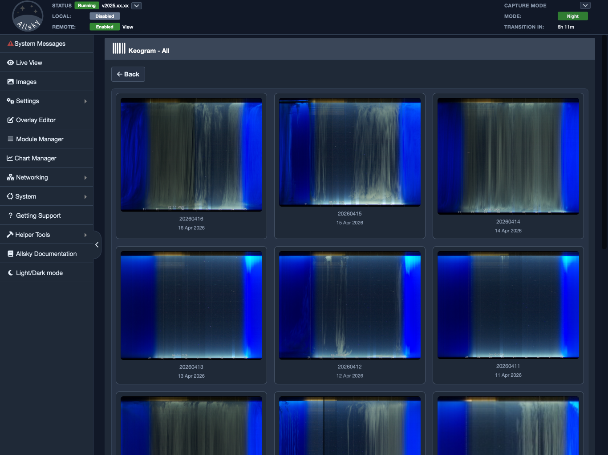
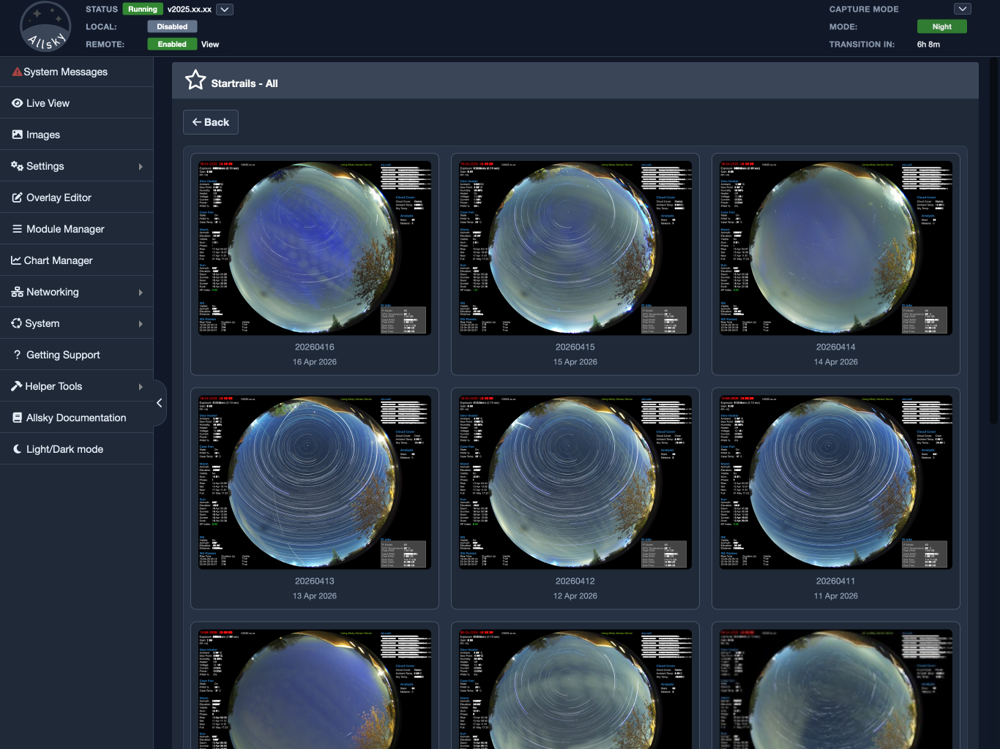
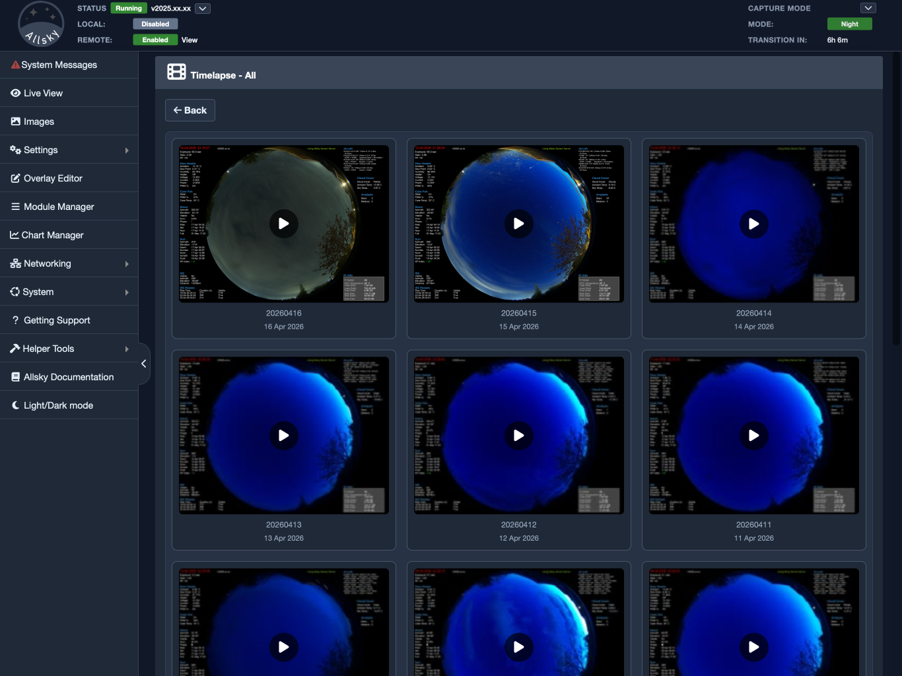

The **Images** page of the WebUI is where you browse the files Allsky has saved. Although the page title is **Images**, this page is really a general viewing area for the output Allsky creates. It gives you one place where you can move between the original saved frames and the processed products that were generated from them.

For most users, this becomes the normal starting point when checking how a night went. If you want to review cloud conditions, confirm that the system captured a particular event, compare one night with another, or simply enjoy the results, this is the page you will probably use most often.

From here you can:

- open the saved images for a specific day
- play that day’s timelapse video
- view the keogram and startrails images
- change the order a day’s saved images are shown in
- delete individual saved images you do not want to keep
- remove a day’s files if you no longer want to keep them

Allsky organises the entries on this page by date, so the normal workflow is simple. You begin by choosing a day, then open whichever output you want to inspect more closely. That date-based layout keeps related files together and makes it easy to move between different views of the same capture period.

The first screen is the day list. Each row represents one saved date and gives you a quick summary of what is available for that day. At a glance, you can see whether there are saved images, a timelapse, a keogram, or startrails. This makes it much easier to find a specific night or check whether a particular output was created, because you do not need to open several pages just to see what exists.

This view is especially useful if you are browsing a large archive. Instead of remembering file names or searching through directories manually, you can scan the list by date and immediately open the night you want. If you are trying to confirm whether Allsky captured something interesting on a certain evening, this is usually the best place to start.

{ width="100%" }

/// caption
Day listing page
///

The **All** row at the top is useful when you want to browse one type of output across many dates instead of focusing on a single day. For example, you can jump directly to all timelapses, all keograms, or all startrails without opening each date one at a time. That is convenient when you want to compare several nights, look for trends over a period of time, or quickly browse only one kind of result.

This can be particularly helpful if you are checking for changes in sky quality, comparing weather across multiple nights, or reviewing how well the system has been performing recently. There is no equivalent option for all saved images because the number of individual frames can be very large, and showing them all in one page would usually be slow and difficult to work with.

When you open a day’s saved images, you are looking at the individual frames Allsky kept for that date. This is the most detailed view on the Images page and is the best choice when you want to examine a particular moment closely. While a timelapse is useful for understanding the overall flow of the night, the saved-image view is the better choice when you need to inspect a single frame carefully.

For example, this is where you might go to check whether focus was good, see when clouds started to move in, confirm the exact time of an aircraft or meteor, or look at how the sky appeared during a specific part of the night. If something in a timelapse catches your attention, the saved images are usually the next place to go.

The image order can be changed, so you can view them oldest-first or newest-first. The **Images Sort Order** setting in the WebUI settings decides the order you see the first time you open the page. The sort button at the top of the page shows the current order, either **Newest first** or **Oldest first**, and clicking it switches to the other one. Your choice is remembered by the browser you made it in, so it applies each time you open a day’s images in that browser and does not change the WebUI setting or what other browsers show.

{ width="100%" }

/// caption
Saved images for a single day
///

You can also delete saved images from this page. Clicking a thumbnail opens the image in a larger viewer, and the trash button in the toolbar at the top of that viewer deletes the image being shown. You are asked to confirm first, and once the image has been deleted the viewer moves on to the next one.

To delete several images at once, click **Select**. While **Select** is on, clicking a thumbnail selects or deselects it instead of opening it. Holding Shift while you click applies the same change to every image between that thumbnail and the one you clicked before it, which is useful for marking a run of cloudy or overexposed frames. A red **Delete** button appears next to **Select** and shows how many images are selected, for example **Delete 12**. Clicking it asks you to confirm and then deletes all of the selected images. Clicking **Select** again turns selection off and clears anything you had selected.

{ width="100%" }

/// caption
Images selected for deletion
///

Deleting an image is permanent. The image and its thumbnail are removed from the Pi and cannot be recovered. The image’s entry in the Allsky database is removed as well. If the database is disabled in the Allsky settings at that moment, the entry stays in the database. A timelapse, keogram, or startrails that already exists for that day was built before the images were deleted, so it still includes those frames until it is created again. Copies that were already uploaded to a remote Website or remote server are not removed.

Timelapse videos are usually the fastest and most natural way to review a full day. Instead of stepping through individual images one by one, you can watch the sky change as a continuous sequence. This gives you a quick understanding of what happened over time and makes it much easier to recognise motion, transitions, and longer patterns.

For many users, the timelapse is the first thing to open when checking a date. It is often the easiest way to spot moving cloud, changing sky brightness, sunrise or sunset transitions, passing weather, and anything unusual that happened across the capture period. If you only have a few moments to review a day, the timelapse is usually the most efficient place to begin.

Keograms and startrails give you two additional ways to review the same night, each with a different purpose. A keogram compresses the changing sky into a single time-based image, which makes gradual changes easier to recognise at a glance. It is useful for spotting shifts in brightness, cloud cover, twilight progression, or other broad patterns that may be less obvious when looking at separate frames.

A startrails image combines the movement of the stars over time into a single result. This can be visually impressive, but it is also useful because it provides a clear summary of the apparent motion in the sky during the capture period. Together, keograms and startrails offer a different kind of overview from both the timelapse and the individual saved images.

{ width="100%" }

/// caption
Keogram views
///

{ width="100%" }

/// caption
Startrails views
///

A common workflow is:

- Open the **Images** page
- open the timelapse for a quick overview
- check the keogram or startrails for a different summary of the day
- return to the saved images if you want to inspect a specific frame

Keeping everything grouped by date makes that process straightforward. You do not need to think in terms of where files are stored on disk or how they were created. Instead, you simply choose a date and move between the available views until you find the level of detail you need.

The Images page also helps with storage management. Over time, saved images and generated outputs can use a meaningful amount of disk space, especially on systems that run continuously. If you no longer want to keep a day’s files, you can delete that day from the list (or change the **Days To Keep** setting in the WebUI).

This is useful when you want to remove unimportant captures, clear out bad or incomplete data, or recover storage space on the system. Managing files by day is usually the most practical approach because all of the related output for that capture period stays grouped together. In most cases, it is easier to decide whether you want to keep or remove an entire day than to manage the files one by one. When only a few frames in a day are unwanted, you can delete just those from that day’s saved images, as described above.

{ width="100%" }

/// caption
Timelapse video view
///

If a day does not show a timelapse, keogram, or startrails image, that usually means that output was not created or was not saved for that date. The Images page is mainly a viewer. It shows you what is available, but it does not generate missing files.

If you expected something to appear and it is missing, the next step is usually to check the related Allsky settings, the save and upload behaviour for that type of output, or the processing steps that create it. In other words, a missing item here usually points to how that output was produced or stored, rather than to a problem with the Images page itself.

The Images page is one of the most useful parts of the WebUI because it brings all of your saved output together in one place and presents it in a way that is easy to browse. Whether you want a fast overview of the night, a compact summary of changing conditions, or a close look at individual frames, this is where you do it.

For day-to-day use, it is the part of the WebUI that turns Allsky’s saved output into something practical to review, compare, and manage.
