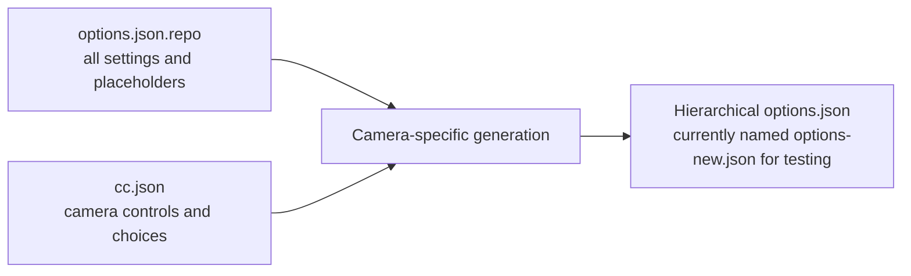

# The options file

`config_repo/options.json.repo` is the source file for the settings schema. It describes every setting Allsky knows about, including controls which a particular camera may not support. The generated `options.json` is specific to the selected camera: its limits, defaults, available choices and visibility have been resolved using that camera's capabilities. A developer changing the settings model should edit this source file and regenerate the output, rather than changing a generated file by hand.

!!! info "The temporary `options-new.json` name"

    During development, the generated file is named `config/options-new.json`. It will be named `config/options.json` when this work is complete. The hierarchical format is the same in both cases.

## Structure of the source file

`options.json.repo` is a JSON object with one top-level member, `sections`. Its value is an ordered object of categories. A category has a `label` for the interface and either a `settings` object, a `sections` object containing smaller sections, or both. A section follows the same pattern, so the structure can be extended without changing the shape of a field. The source file currently uses at most one level of subsections: for example, `daynight` contains `daytimesettings`, `nighttimesettings` and `dayandnight`, whereas `keograms` contains its settings directly.

The key in a `settings` object is the setting's identifier. It is also the name used in the settings file, in dependency expressions and by code which looks up the option. A field definition therefore has **no separate `name` member**. Identifiers are case-sensitive; names such as `REMOTEWEBSITE_HOST` deliberately use capitals. JSON member order is retained when the options document is generated and determines the order in which sections and fields appear in the Settings page.

```json
{
  "sections": {
    "daynight": {
      "sections": {
        "daytimesettings": {
          "label": "Daytime",
          "settings": {
            "dayautoexposure": {
              "default": true,
              "description": "Enable to use daytime auto-exposure.",
              "label": "Auto-Exposure",
              "type": "boolean",
              "usage": "capture",
              "action": "reload",
              "metadata": { "level": "beginner" }
            }
          }
        }
      },
      "label": "Day/Night Settings"
    }
  }
}
```

This is a shortened example of the real document; it shows the relationship between a category, a subsection and a named field. The `label` belongs to the section in which it appears, while the field's own `label` names its control. Where a category needs a prominent caution, `warning` holds plain text alongside its `label` and `settings`. The Database category uses this arrangement. A warning is section metadata, not a setting and not a child section created solely to display a message.

Section headings come from `label` values. They are not field definitions and should not be added to a `settings` object.

## From source file to camera-specific options

Generation reads `options.json.repo` and the selected camera's capabilities from `config/cc.json`. The builder, currently `scripts/createAllskyOptionsNew.php`, walks the sections in order and processes each field. It keeps the section keys and labels, replaces camera-dependent placeholders inside the field definition, and writes the resolved hierarchical document. The generated document is currently named `options-new.json` for testing and will be named `options.json` when this work is complete.



For `minimum`, `maximum` and `default`, `_min`, `_max` and `_default` refer to a camera control with the common name. A field named `dayexposure`, for example, uses the `exposure` control when its value is `_min`; `day_min` instead refers to the `dayexposure` control. The corresponding `night_` forms work in the same way. This distinction matters when day and night have different defaults. If a required camera value is absent, the hierarchical builder removes that bound or default and marks the field as not displayed. It does not replace an unknown value with an arbitrary constant.

`display` may be a JSON boolean or the string `_display`. The latter becomes true when the corresponding camera control exists and false when it does not. Camera-specific select choices use a one-element `options` array containing `bin_values`, `type_values`, `rotation_values` or `camerainfo_values`; generation expands it from the camera capabilities or the connected-camera list. The `camera` and `camerainfo` defaults are also filled from the selected camera, even though their source definitions have empty defaults. Ordinary strings, including `${ALLSKY_ENV}` in `source`, remain strings: `${ALLSKY_ENV}` is expanded when the Settings page reads or writes the source file, not when camera capabilities are resolved.

The builder supplies a numeric `step` when one has not been specified and can infer a display `unit` for recognised names such as exposure, delay, bitrate and image dimensions. It retains an explicit value from the source file. Field metadata, including `level`, remains attached to the field. Generation does not evaluate dependencies or choose a visibility level; the Settings page handles those later.

## Anatomy of a field

The following field is taken from the Daytime section, with the explanatory text shortened. It illustrates a camera-dependent range, a fixed display increment and a dependency. The camera supplies the numeric bounds and default; the source file supplies the field's meaning and presentation rules.

```json
"daymaxautoexposure": {
  "minimum": "_min",
  "maximum": "_max",
  "default": "_default",
  "description": "Maximum daytime auto-exposure time in milliseconds.",
  "label": "Max Auto-Exposure",
  "label_prefix": "Daytime",
  "type": "float",
  "usage": "capture",
  "action": "reload",
  "step": "0.01",
  "unit": "ms",
  "metadata": {
    "level": "beginner",
    "layout": { "group": "dayauto" },
    "depends": { "booldependson": "takedaytimeimages AND dayautoexposure" }
  }
}
```

Every field in `options.json.repo` should declare its `type`, and a displayed field should have a useful `label` and `description`. A default is strongly recommended wherever an empty value would be invalid. The tables below describe the field members used by the current source file, plus `readonly`, which the new Settings page understands. Members are optional unless their description says otherwise. Types and values should be chosen for the **stored setting**, rather than for the appearance of its form control.

### Identity, values and validation

| Member | Meaning |
| --- | --- |
| `type` | Required control type. It determines the editor, validation and conversion of the submitted value. The supported types are described below. |
| `default` | Value used when the setting has no saved value and when defaults are restored. It can be a literal of the appropriate type or a camera placeholder. The generator supplies the defaults for `camera` and `camerainfo`. |
| `minimum`, `maximum` | Numeric limits used by validation and field help. Each may be a literal number or a camera placeholder. Do not put an unresolved placeholder into a generated file. |
| `step` | Increment used by numeric controls. Store it as a numeric string, such as `"0.01"`, where precision matters. Generation infers an increment if one is omitted. |
| `unit` | Short display suffix, such as `ms`, `px`, `fps` or `days`. It helps the reader interpret a number; it is not part of the stored value. Generation can infer it for recognised settings. |
| `options` | Choices for `select_text` and `select_integer`. Use objects with `value` and `label`, or one of the recognised camera-choice placeholders. Submitted values are checked against the generated choices. |
| `optional` | Allows an empty value. When false or absent, a field without a default cannot be left empty. |

The source file uses JSON booleans, numbers and strings deliberately. For example, `"_default"` is a placeholder string, `true` is a boolean default, and `0` is a numeric default. Quoting a numeric literal changes its JSON type. The Settings page normalises submitted booleans, integers and floats before saving them, but a field definition should still express the intended type clearly.

### Presentation and storage

| Member | Meaning |
| --- | --- |
| `label` | Short name shown beside the control. It is separate from the identifier used as the key in `settings`. |
| `label_prefix` | Context added where a short label would otherwise be ambiguous, for example “Daytime” before “Gain”. |
| `description` | Help text for the setting. Existing definitions can contain HTML for links and emphasis; keep it brief enough to work within the Settings page. |
| `display` | `true` or absent means the field can be shown; `false` hides it. `_display` asks generation to decide from the camera's controls. |
| `settingsonly` | Keeps an internal setting in the schema and settings file while excluding it from the editable page. It is used, for example, for automatically maintained camera information and overlay filenames. |
| `readonly` | Displays a value without allowing edits on the new Settings page. This is recognised by the page even though the current source file has no field using it. |
| `source` | External JSON file holding the value instead of the main settings file. The Settings page recognises `${HOME}`, `${ALLSKY_HOME}` and `${ALLSKY_ENV}` in this path. |
| `usage` | Declares the consumer of the setting. `capture` is the value used for camera capture options. It does not, by itself, request a service action. |
| `carryforward` | Marks a value for transfer when settings are carried forward to a different camera. Use it only when the value is not tied to the old camera's capabilities. |
| `checkchanges` | Sends a changed value through `makeChanges.sh` for the additional checks or side effects associated with that option. |
| `action` | Service action requested after a change. Current definitions use `reload`, `restart` and `stop`; absence means no explicit action. |

`source` changes where a value lives, not what it is called: the key remains the setting identifier. A value in `${ALLSKY_ENV}` is read and written by that name in the resolved external file. Likewise, `carryforward` affects camera changes rather than routine saves. Keep these concerns separate when introducing a field; a capture option stored externally may need both a `source` and an `action`.

### Related controls and metadata

| Member | Meaning |
| --- | --- |
| `startfield`, `endfield` | Name the matching field in a start/end time pair. They allow the time picker to work with the other end of the interval. |
| `latitudefield`, `longitudefield` | Name the matching coordinate field for controls which edit a location together. |
| `metadata.layout` | Controls grouping in the new page. `group` is a shared group key; `groupname` supplies its heading; `singlerow` gives a field a full row; `newline` starts a new row. |
| `metadata.level` | Minimum Settings page level at which the field is shown: `beginner`, `intermediate` or `advanced`. Every field in the source file has one. |
| `metadata.depends` | Holds `booldependson`, `booldependsoff` and `valuedependson`, described in the next section. |
| `popup-yesno`, `popup-yesno-value` | Historical confirmation prompt and its trigger value. They remain in one source definition, but the new Settings page does not currently act on them. Do not rely on them for a new field. |

`metadata` is an object, not a list. It contains `level` alongside any `layout` or `depends` objects a field needs. If two fields share a `layout.group`, keep them adjacent in the section: the page groups adjacent controls with the same key. A `groupname` is normally needed only once. `singlerow` and `newline` are presentation hints and do not affect stored data.

### Settings levels

The level is a visibility threshold for the editable Settings page. **Beginner** shows beginner fields, **Intermediate** shows beginner and intermediate fields, and **Advanced** shows every field supported by the camera. The filter also applies to search results and category navigation. It does not delete values or change the options generated for a camera. A setting which is hidden at the chosen level keeps its saved value.

The source file currently marks the settings in the Allsky Guide's Quick Start list as `beginner`, together with a few controls needed to use them, including nighttime capture and the level selector itself. The remaining fields are `advanced`. No field is assigned to `intermediate` yet, so that view currently contains the same fields as Beginner. New fields should be assigned deliberately: use Beginner for settings most users must find during initial setup, Intermediate for routine customisation, and Advanced for specialised controls. A missing or unrecognised level is treated as Advanced by the page, but every source definition should declare `metadata.level` explicitly.

`settingslevel` is an ordinary `select_text` setting in the WebUI section's **Settings Fields** group. Its default is `advanced`, which preserves the full page for existing installations. Changing it updates the current page immediately, and saving the form persists the preference. The page still honours camera support, `display`, `settingsonly` and dependencies; a level does not override those rules.

Dependencies use setting identifiers, including their exact case. `booldependson` requires the named boolean or non-zero numeric setting to be on; `booldependsoff` requires it to be off. Within either expression, `AND` binds conditions inside an `OR` group, so `savedaytimeimages AND imagecreatethumbnails OR savenighttimeimages AND imagecreatethumbnails` means thumbnail creation must be enabled and at least one image-saving mode must be enabled. Separate `booldependson` and `booldependsoff` rules must **both** allow the field. The global `settingsdependencies` preference can disable dependency handling.

`valuedependson` has the form `setting_name=pattern`. A `*` matches any text, a `|` separates alternatives, and a bracket range such as `[1-9]` is accepted. For example, `minitimelapsenumimages=[1-9]*` enables a control when the configured image count is positive. A failed value dependency hides its field; a failed boolean dependency disables it. The server checks the same rules before accepting a submitted change. Avoid referring to a field itself or creating cycles: every controller should be another real setting whose value the page can read.

### Supported field types

The `type` is the logical kind of a setting as well as the control selected for it. The source file currently uses the following types. Their special editors are provided by the Settings page; a select type also requires `options`.

| Type | Stored value and editor |
| --- | --- |
| `boolean` | JSON `true` or `false`, edited as a switch. |
| `integer`, `float`, `percent` | Numeric settings. `percent` is displayed with a percentage unit but stored without a `%` character. |
| `text`, `widetext`, `password` | Strings. The password editor masks the value; `widetext` allows more room for a long string. |
| `select_text`, `select_integer` | A choice from `options`, stored as text or an integer respectively. |
| `color` | A hexadecimal colour string, edited with a colour picker. |
| `starttime`, `endtime` | Time values used for a paired interval; the page accepts `HH:MM` or its supported sun-event names. |
| `latitude`, `longitude` | Coordinate controls stored as text. |
| `sunangle` | A Sun angle in degrees, edited with the graphical picker and stored as a JSON floating-point number. |
| `daystokeep` | Whole number of days, with an estimate picker. |
| `locale`, `timeformat` | Locale selection and a `strftime` format string. The time format has a live preview and a 200-character limit. |
| `vcodec`, `pixfmt` | Video codec and pixel-format selectors. |

Section headings are defined by the surrounding structure and its labels, rather than by a field `type`.

`sunangle` is a specialised field type, but it does not introduce a new storage format. The Angle field declares `"type": "sunangle"`, a numeric default such as `-6.0`, and numeric limits of `-90.0` and `90.0`. The graphical picker writes a decimal value, which the Settings page validates and saves as a float.

## Making a change safely

Add a field beneath the category or subsection where a user would expect to find it. Use a stable identifier, choose the stored type and default, and add camera placeholders only where the camera genuinely determines a value. If the field is only meaningful when another option is enabled, add a dependency instead of leaving a control that appears editable but cannot have an effect. For a new select field, define the generated choices explicitly or use a supported camera-choice placeholder.

Regenerate against a representative `cc.json` and inspect the resulting field, including a camera that lacks the relevant control when the field is camera-specific. The following command writes the generated document to a temporary file for inspection:

```sh
php scripts/createAllskyOptionsNew.php \
  --cc-file config/cc.json \
  --repo-file config_repo/options.json.repo \
  --options-file /tmp/allsky-options-check.json
```

The output should preserve the intended section and setting order, contain concrete camera values in place of placeholders, and have no dangling dependency names. The file in `config_repo` remains the authoritative definition when the generated file is named `options.json`.
